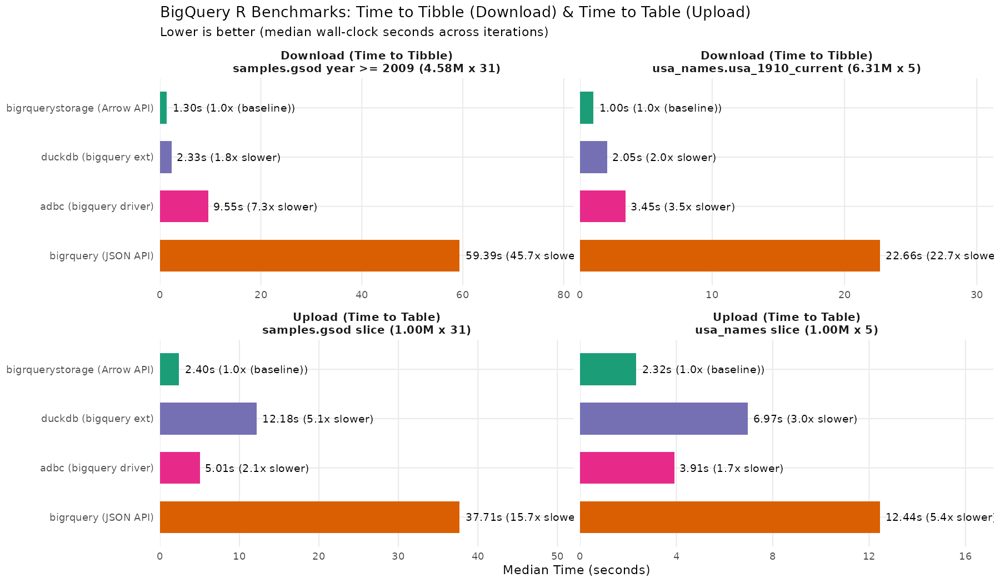

<!-- README.md is generated from README.Rmd. Please edit that file -->

```{r, include = FALSE}
knitr::opts_chunk$set(
  collapse = TRUE,
  comment = "#>",
  fig.path = "man/figures/README-",
  out.width = "100%"
)
```

# bigrquerystorage

<!-- badges: start -->
[](https://cran.r-project.org/package=bigrquerystorage)
[](https://github.com/meztez/bigrquerystorage/actions/workflows/R-CMD-check.yaml)
<!-- badges: end -->

Use Google's [BigQuery Storage API](https://cloud.google.com/bigquery/docs/reference/storage/rpc/google.cloud.bigquery.storage.v1) from R, supporting both the [BigQueryRead](https://cloud.google.com/bigquery/docs/reference/storage/rpc/google.cloud.bigquery.storage.v1#bigqueryread) and [BigQueryWrite](https://cloud.google.com/bigquery/docs/reference/storage/rpc/google.cloud.bigquery.storage.v1#bigquerywrite) gRPC interfaces.

`bigrquerystorage` powers high-throughput Arrow transfers in `bigrquery::bq_table_download(..., api = "arrow")` and `bigrquery::bq_table_upload(..., api = "arrow")`, and can also be called directly via `bqs_table_download()` and `bqs_table_upload()`.

## Advantages over BigQuery REST API

Unlike the BigQuery REST API, the BigQuery Storage API streams native binary Apache Arrow `RecordBatch` payloads over parallel gRPC (HTTP/2) connections with `ZSTD` / `LZ4` compression instead of paginated JSON, and does not count against per-project REST tabledata/extract job quotas.

### Performance (`bigrquerystorage` Arrow API vs `bigrquery` JSON, `duckdb`, and `adbc`)

In R benchmarks on BigQuery public datasets, **`bigrquerystorage`** (`bigrquery` with `api = "arrow"`) is **23X to 46X times faster** on download (*Time to Tibble*) and **5X to 16X times faster** on upload (*Time to Table*) than `bigrquery` without the Arrow API (`api = "json"`), while performing **1.8X to 2.0X times faster** on download (and **3.0X to 5.1X times faster** on upload) than `duckdb` (`bigquery` extension), and **3.5X to 7.3X times faster** on download (and **1.7X to 2.1X times faster** on upload) than the `adbc` BigQuery driver.

```{r benchmark-plot, echo=FALSE, fig.alt="BigQuery R Benchmarks: Time to Tibble (Download) and Time to Table (Upload)"}

```

#### Download Benchmark — Time to Tibble (TTT)

| Dataset | Dimensions (In-Memory) | Method | Median TTT (s) | Transfer Speed (MB/s) | Throughput (M rows/s) | vs `bigrquery` (JSON) | vs `bigrquerystorage` (Arrow) |
|:---|:---|:---|---:|---:|---:|---:|:---|
| `samples.gsod` `year >= 2009` (4.58M x 31) | 4.58M x 31 (752 MB) | **bigrquerystorage (Arrow API)** | 1.30 s | 577.3 MB/s | 3.52 M/s | **45.7X faster** | 1.0x (baseline) |
| `samples.gsod` `year >= 2009` (4.58M x 31) | 4.58M x 31 (752 MB) | **duckdb (bigquery ext)** | 2.33 s | 322.9 MB/s | 1.97 M/s | **25.5X faster** | 1.8x slower |
| `samples.gsod` `year >= 2009` (4.58M x 31) | 4.58M x 31 (752 MB) | **adbc (bigquery driver)** | 9.55 s | 78.7 MB/s | 0.48 M/s | **6.2X faster** | 7.3x slower |
| `samples.gsod` `year >= 2009` (4.58M x 31) | 4.58M x 31 (752 MB) | **bigrquery (JSON API)** | 59.39 s | 12.7 MB/s | 0.08 M/s | 1.0x (baseline) | 45.7x slower |
| `usa_names.usa_1910_current` (6.31M x 5) | 6.31M x 5 (194 MB) | **bigrquerystorage (Arrow API)** | 1.00 s | 194.8 MB/s | 6.32 M/s | **22.7X faster** | 1.0x (baseline) |
| `usa_names.usa_1910_current` (6.31M x 5) | 6.31M x 5 (194 MB) | **duckdb (bigquery ext)** | 2.05 s | 94.9 MB/s | 3.08 M/s | **11.1X faster** | 2.0x slower |
| `usa_names.usa_1910_current` (6.31M x 5) | 6.31M x 5 (194 MB) | **adbc (bigquery driver)** | 3.45 s | 56.3 MB/s | 1.83 M/s | **6.6X faster** | 3.5x slower |
| `usa_names.usa_1910_current` (6.31M x 5) | 6.31M x 5 (194 MB) | **bigrquery (JSON API)** | 22.66 s | 8.6 MB/s | 0.28 M/s | 1.0x (baseline) | 22.7x slower |

#### Upload Benchmark — Time to Table (TTT)

| Dataset | Dimensions (In-Memory) | Method | Median TTT (s) | Transfer Speed (MB/s) | Throughput (M rows/s) | vs `bigrquery` (JSON) | vs `bigrquerystorage` (Arrow) |
|:---|:---|:---|---:|---:|---:|---:|:---|
| `samples.gsod` slice (1.00M x 31) | 1.00M x 31 (164 MB) | **bigrquerystorage (Arrow API)** | 2.40 s | 68.4 MB/s | 0.42 M/s | **15.7X faster** | 1.0x (baseline) |
| `samples.gsod` slice (1.00M x 31) | 1.00M x 31 (164 MB) | **duckdb (bigquery ext)** | 12.18 s | 13.5 MB/s | 0.08 M/s | **3.1X faster** | 5.1x slower |
| `samples.gsod` slice (1.00M x 31) | 1.00M x 31 (164 MB) | **adbc (bigquery driver)** | 5.01 s | 32.7 MB/s | 0.20 M/s | **7.5X faster** | 2.1x slower |
| `samples.gsod` slice (1.00M x 31) | 1.00M x 31 (164 MB) | **bigrquery (JSON API)** | 37.71 s | 4.3 MB/s | 0.03 M/s | 1.0x (baseline) | 15.7x slower |
| `usa_names` slice (1.00M x 5) | 1.00M x 5 (32 MB) | **bigrquerystorage (Arrow API)** | 2.32 s | 13.7 MB/s | 0.43 M/s | **5.4X faster** | 1.0x (baseline) |
| `usa_names` slice (1.00M x 5) | 1.00M x 5 (32 MB) | **duckdb (bigquery ext)** | 6.97 s | 4.6 MB/s | 0.14 M/s | **1.8X faster** | 3.0x slower |
| `usa_names` slice (1.00M x 5) | 1.00M x 5 (32 MB) | **adbc (bigquery driver)** | 3.91 s | 8.1 MB/s | 0.26 M/s | **3.2X faster** | 1.7x slower |
| `usa_names` slice (1.00M x 5) | 1.00M x 5 (32 MB) | **bigrquery (JSON API)** | 12.44 s | 2.5 MB/s | 0.08 M/s | 1.0x (baseline) | 5.4x slower |

*Benchmarks executed in R (R version 4.6.0) over 3 iterations per workload using `r-dbi/bigrquery#695` (`api = "arrow"` vs `api = "json"`), `duckdb` (`bigquery` extension), and `adbcdrivermanager` (`bigquery` driver); see [`scripts/benchmark_bigrquerystorage.R`](https://github.com/meztez/bigrquerystorage/blob/main/scripts/benchmark_bigrquerystorage.R).*

## Details

`bigrquerystorage` combines a multi-threaded C++17 `gRPC` client with the [`nanoarrow`](https://arrow.apache.org/nanoarrow/) R package to stream Arrow IPC `RecordBatch` payloads directly to and from R `tibble`, `data.frame`, `data.table`, or `nanoarrow_array_stream` objects:

- **Parallel multi-stream reads & writes**: Concurrently reads from multiple `ReadSession` streams and appends across parallel `WriteStream` workers (`options(bigrquerystorage.threads = n)`).
- **Server-side pushdown & snapshots**: Supports column projection (`selected_fields`), SQL predicate filtering (`row_restriction`), table sampling (`sample_percentage`), and table time-travel (`snapshot_time`).
- **Arrow buffer compression**: Automatically uses `ZSTD` / `LZ4` Arrow IPC compression when available (`compression = "auto"`).
- **Full BigQuery type fidelity**: Supports `INT64` (`bit64::integer64`), `NUMERIC` (`Decimal128`), `BIGNUMERIC` (`Decimal256`), `DATE`, `TIME` (`hms`), `DATETIME`, `TIMESTAMP`, `BYTES` (`blob`), `GEOGRAPHY` (`wk::wkt`), and nested `STRUCT` / `RECORD` and `REPEATED` (`ARRAY`) columns.

## Installation

#### CRAN

```r
install.packages("bigrquerystorage")
```

#### GitHub (development version)

```r
# Using pak or remotes:
pak::pak("meztez/bigrquerystorage")
# remotes::install_github("meztez/bigrquerystorage")
```

### System requirements (when building from source)

Pre-compiled binary packages from CRAN on macOS and Windows do not require additional system dependencies. Building from source requires:

- [gRPC](https://github.com/grpc/grpc) (`libgrpc++` and `grpc_cpp_plugin`)
- [Protocol Buffers](https://github.com/protocolbuffers/protobuf) (`libprotobuf` and `protoc`)
- `pkg-config` (or `pkgconf`) and a C++17 compiler
- *Optional (recommended for `ZSTD` / `LZ4` Arrow compression)*: `libzstd` and `liblz4`

#### Debian 11 & 12 / Ubuntu 22.04 & 24.04

```sh
apt-get install -y libgrpc++-dev libprotobuf-dev protobuf-compiler-grpc \
                   libzstd-dev pkg-config
```

#### Fedora 40 & 41 / Rocky Linux 9

```sh
dnf install -y grpc-devel libzstd-devel pkgconf
```

```{=html}
<details><summary>Other Linux distributions</summary>
```

See [`tools/build/linux`](https://github.com/meztez/bigrquerystorage/tree/main/tools/build/linux) for tested Dockerfiles across supported Linux distributions, and please [open an issue](https://github.com/meztez/bigrquerystorage/issues/new/choose) if any instructions need updating.

##### Alpine Linux (3.19, 3.20, 3.21, Edge)

```sh
apk add grpc-dev protobuf-dev re2-dev c-ares-dev zstd-dev
```

##### Older distributions (Ubuntu 20.04, CentOS/RHEL 7 & 8, OpenSUSE 15.x)

System `grpc` packages on these older distributions are either unavailable or too old; compile a recent `gRPC` + `protobuf` toolchain from source and pass `INCLUDE_DIR` / `LIB_DIR` if `pkg-config` is not on `PATH`:

```sh
R CMD INSTALL --configure-vars='INCLUDE_DIR=/usr/local/include LIB_DIR=/usr/local/lib' .
```

```{=html}
</details>
```

#### macOS

If you use Homebrew, install `grpc`, `zstd`, and `pkg-config`. If Homebrew is not installed, the `configure` script automatically downloads static pre-built `grpc` libraries during source installation (macOS Big Sur or later on Intel and Apple Silicon).

```sh
brew install grpc zstd pkg-config
```

#### Windows

To build from source on Windows with R >= 4.3, install [Rtools](https://cran.r-project.org/bin/windows/Rtools/) (`Rtools43` or newer), which includes `grpc`, `protobuf`, and `zstd` in the toolchain. (On R 4.1–4.2, `configure.win` downloads static pre-built `grpc` bundles.)

## Usage

BigQuery Storage API sessions are billed to a parent Google Cloud project (`parent`). You can either use `bigrquery` directly (`api = "arrow"`) or call `bqs_table_download()` and `bqs_table_upload()`:

```{r example, eval=FALSE}
library(bigrquery)
library(bigrquerystorage)

# Set your billing project (can differ from the project hosting the dataset)
project_id <- "your-project-id"

# Option 1: Seamless integration with bigrquery (requires bigrquery with api = "arrow" support)
# df <- bq_table_download("bigquery-public-data.usa_names.usa_1910_current", page_size = NULL, api = "arrow")
# bq_table_upload(bq_table(project_id, "my_dataset", "my_table"), values = mtcars, api = "arrow")

# Option 2: Direct bigrquerystorage calls with server-side column & row filtering
rows <- bqs_table_download(
  x = "bigquery-public-data:usa_names.usa_1910_current",
  parent = project_id,
  selected_fields = c("name", "number", "state"),
  row_restriction = 'state = "WA"'
  # snapshot_time = Sys.time(), # optional POSIXct table snapshot time
  # type = "arrow"              # return a zero-copy nanoarrow_array_stream
)

sprintf(
  "Got %d unique names in states: %s",
  length(unique(rows$name)),
  paste(unique(rows$state), collapse = " ")
)

# Upload a data.frame, tibble, data.table, or nanoarrow stream via BigQuery Storage Write API
bqs_table_upload(
  x = paste0(project_id, ".my_dataset.my_table"),
  values = mtcars,
  create_disposition = "CREATE_IF_NEEDED",
  write_disposition = "WRITE_TRUNCATE"
)
```

Concurrency defaults to up to 16 parallel streams on download and 4–8 parallel streams on upload depending on payload size, and can be tuned globally via `options(bigrquerystorage.threads = 8L)`.

## Authentication

Authentication runs automatically on the first request (`bqs_auth()`):

1. **`bigrquery` credentials**: If `bigrquery` already holds an active token (e.g. via `bigrquery::bq_auth()`), `bigrquerystorage` reuses its OAuth refresh token or access token automatically. Call `bqs_deauth()` if you switch `bigrquery` credentials during an active session.
2. **Application Default Credentials (ADC)**: Otherwise, `gRPC` falls back to Google Application Default Credentials:
   - The service account or user credentials file pointed to by `GOOGLE_APPLICATION_CREDENTIALS` (or `gcloud auth application-default login --billing-project={project}`), or
   - The attached service account when running on Google Cloud (Compute Engine, GKE, Cloud Run, Cloud Functions, App Engine).

```{r auth, eval=FALSE}
bqs_auth()
bqs_deauth()
```

## Notes & Troubleshooting

- Only Apache Arrow serialization is supported (`AVRO` output format is not supported).
- Verbose gRPC logging can be enabled for diagnostics with `bigrquerystorage:::bqs_set_log_verbosity(0)` (`0` = info/verbose, `1` = warning, `2` = error [default]).
- Report issues at <https://github.com/meztez/bigrquerystorage/issues/new/choose>.
